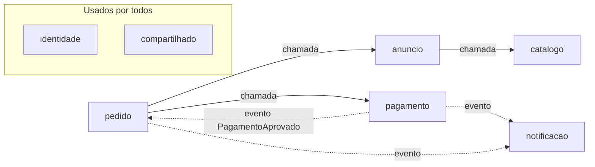
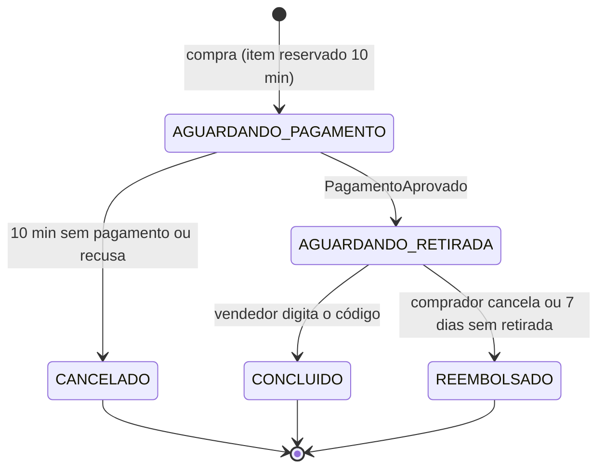

# Montaí — Documento de Requisitos (MVP)

Versão 2.4 de 25/11/2026 · Autor: Pedro Carvalho

## Visão geral

O Montaí é um marketplace regional de hardware: lojas verificadas vendem peças novas e pessoas físicas vendem usadas, num catálogo estruturado por especificação.

**Problema.** Comprar peça de PC, principalmente usada, é lento e arriscado. Anúncios em OLX, Mercado Livre e grupos são texto livre, sem compatibilidade verificável e com risco de golpe, como o comprovante de Pix falso na retirada em mãos.

**Solução.** Cada anúncio aponta para um produto do catálogo com specs padronizadas. O dinheiro fica retido até o comprador confirmar o recebimento, então ninguém precisa levar dinheiro vivo nem confiar em comprovante. Nas próximas fases, um montador de PC com IA monta builds compatíveis com os anúncios reais do site.

**Objetivo do MVP (Fases 0 a 3).** Provar o fluxo de ponta a ponta pela API (Fases 0 e 1): cadastro → anúncio → busca → compra → pagamento simulado → retirada em mãos com código → pedido concluído, com valores corretos no ledger. Depois, colocar no ar com uma interface mínima (Fase 2) e validar com usuários reais em Recife (Fase 3).

## Escopo

O MVP cobre o marketplace com retirada em mãos, pagamento simulado, front mínimo e deploy gratuito; IA, envio, disputa e pagamento real ficam para as fases seguintes.

| Dentro do MVP | Fora do MVP (fase) |
| --- | --- |
| Cadastro PF e Loja, confirmação de e-mail, login JWT | Login com Google (futuro) |
| Catálogo com 8 categorias, seed, sugestão com aprovação | Importador de specs com IA (5), similaridade e mesclagem (6) |
| Anúncios com fotos, estoque de loja, regras de PF | Periféricos (futuro) |
| Busca por specs, preço, estado e cidade/UF | Busca por raio em km (6) |
| Pedido com retirada em mãos e código de confirmação | Envio com rastreio, disputa (6) |
| Mensagens do pedido para combinar a retirada | Chat em tempo real e antes da compra (6) |
| Pagamento simulado (Pix/cartão) e ledger | Mercado Pago em sandbox, webhooks (7) |
| Aprovação manual de loja pelo moderador | Consulta de CNPJ por API, selfie PF (6) |
| Notificações por e-mail e no sistema | Tempo real via WebSocket (futuro) |
| — | Compatibilidade e montador (4), montador com IA e voz (5) |
| Swagger UI (Fases 0 e 1); front mínimo e deploy gratuito (Fase 2) | Front completo (evolui a partir da Fase 2) |

## Atores e perfis de acesso

Quatro papéis; contas de PF e de Loja são tipos distintos e não se convertem.

| Papel | Quem é | Pode no MVP |
| --- | --- | --- |
| `USER` (PF) | Pessoa física com CPF | Comprar; anunciar só peças usadas (quantidade 1); gerenciar os próprios anúncios e pedidos; sugerir produto |
| `STORE` (Loja) | Pessoa jurídica com CNPJ | Após aprovação: anunciar peças novas com estoque; gerenciar anúncios e vendas; sugerir produto |
| `MODERATOR` | Equipe da plataforma | Aprovar lojas e produtos sugeridos; moderar anúncios; cadastrar e editar produtos |
| `ADMIN` | Equipe da plataforma | Tudo do moderador + gerenciar moderadores e configurações (prazos, comissão, limites) |

Visitante sem login pode buscar e ver anúncios, mas não comprar nem anunciar. Nas Fases 0 e 1 só existe a PF; lojas, moderador e admin entram na Fase 3.

## Requisitos funcionais

51 requisitos em 8 módulos; a fase indica quando cada um é entregue.

| ID | Módulo | Requisito | Fase |
| --- | --- | --- | --- |
| RF01 | identidade | Cadastrar PF com nome, e-mail, CPF válido, senha e aceite dos termos | 0 |
| RF02 | identidade | Cadastrar Loja com razão social, nome fantasia, CNPJ válido, e-mail e senha, em status pendente | 3 |
| RF03 | identidade | Confirmar e-mail por link com token válido por 24h | 0 |
| RF04 | identidade | Fazer login e receber access token e refresh token | 0 |
| RF05 | identidade | Renovar a sessão com refresh token e encerrar com logout | 0 |
| RF06 | identidade | Consultar os próprios dados (`/me`) | 0 |
| RF07 | identidade | Moderador aprovar ou rejeitar loja, com motivo | 3 |
| RF08 | catalogo | Listar categorias e seus atributos | 1 |
| RF09 | catalogo | Buscar produtos por texto (marca, modelo, chip) e categoria, paginado | 1 |
| RF10 | catalogo | Moderador/admin cadastrar, editar e inativar produtos | 3 |
| RF11 | catalogo | Validar as specs do produto contra os atributos da categoria | 1 |
| RF12 | catalogo | Vendedor sugerir produto inexistente, com link da fonte | 3 |
| RF13 | catalogo | Moderador aprovar ou rejeitar produto sugerido, com motivo | 3 |
| RF14 | catalogo | Registrar histórico de revisões a cada edição de specs | 3 |
| RF15 | catalogo | Carregar seed de ~100 produtos em ambiente de desenvolvimento | 1 |
| RF16 | anuncio | Criar anúncio com produto, estado de conservação, preço, quantidade, descrição e CEP | 1 |
| RF17 | anuncio | Preencher cidade, bairro e UF a partir do CEP (ViaCEP) | 1 |
| RF18 | anuncio | Enviar até 6 fotos por anúncio | 1 |
| RF19 | anuncio | Publicar automaticamente o rascunho quando o produto sugerido for aprovado | 3 |
| RF20 | anuncio | Editar, pausar, reativar e remover os próprios anúncios | 1 |
| RF21 | anuncio | Buscar anúncios por categoria, specs, faixa de preço, estado, tipo de vendedor e cidade/UF, com ordenação e paginação (filtro por tipo de vendedor a partir da Fase 3, quando existirem lojas) | 1 |
| RF22 | anuncio | Ver detalhe do anúncio sem endereço exato do vendedor | 1 |
| RF39 | anuncio | Informar condição em escala com descrição: Novo lacrado, Novo aberto, Seminovo (9,5), Usado (9), Usado (8), Usado (7), Com defeito | 1 |
| RF40 | anuncio | Informar caixa, acessórios inclusos (cabos, backplate, manual), nota fiscal e garantia restante | 1 |
| RF41 | anuncio | Mostrar ao vendedor, enquanto digita o preço, quanto ele recebe após a comissão | 1 |
| RF42 | anuncio | Comprador fazer perguntas públicas no anúncio e vendedor responder | 3 |
| RF23 | pedido | Comprar anúncio na modalidade retirada em mãos, reservando o item | 1 |
| RF24 | pedido | Gerar código de confirmação de 6 dígitos após pagamento aprovado, exibido ao comprador no detalhe do pedido (também por e-mail a partir da Fase 3) | 1 |
| RF25 | pedido | Vendedor informar o código para concluir o pedido | 1 |
| RF26 | pedido | Comprador cancelar o pedido antes de passar o código | 1 |
| RF27 | pedido | Cancelar automaticamente pedido não pago no prazo | 1 |
| RF28 | pedido | Avisar no 5º dia e reembolsar no 7º dia sem retirada | 3 |
| RF29 | pedido | Listar minhas compras e minhas vendas com status | 1 |
| RF30 | pedido | Registrar histórico de cada mudança de estado do pedido | 1 |
| RF49 | pedido | Mensagens do pedido entre comprador e vendedor para combinar a retirada, salvas no histórico do pedido | 1 |
| RF31 | pagamento | Cobrar via gateway (simulado no MVP) por Pix ou cartão | 1 |
| RF32 | pagamento | Simular aprovação ou recusa em ambiente de desenvolvimento | 1 |
| RF33 | pagamento | Registrar no ledger valores retidos, liberados e estornados, com comissão | 1 |
| RF34 | pagamento | Estornar o valor em cancelamento ou reembolso | 1 |
| RF35 | notificacao | Enviar e-mails nos eventos de pedido, pagamento, venda, prazo e aprovação | 3 |
| RF36 | notificacao | Listar minhas notificações e marcar como lidas | 3 |
| RF37 | admin | Admin alterar prazos, comissão e limites de PF | 3 |
| RF38 | admin | Admin gerenciar contas de moderador | 3 |
| RF43 | identidade | Listar pendências para começar a vender (dados, endereço, e-mail, verificação) | 3 |
| RF44 | catalogo | Buscar produto ao anunciar por nome, modelo ou part number do fabricante | 3 |
| RF50 | web | Interface web para cadastro, login, busca, detalhe, anúncio, compra com pagamento simulado, meus pedidos e mensagens | 2 |
| RF51 | web | Conta de demonstração com dados de exemplo, para testar o fluxo sem se cadastrar | 2 |
| RF45 | pagamento | Saldo do vendedor e saque via Pix com taxa fixa | 6 |
| RF46 | identidade | PIN de segurança de 4 dígitos para saque e ações sensíveis | 6 |
| RF47 | anuncio | Chat em tempo real (WebSocket) e conversa antes da compra | 6 |
| RF48 | anuncio | Vendedor informar dimensões do pacote e preço de custo (opcional) | 6 |

## Regras de negócio

Valores marcados como configuráveis são padrões que o admin pode alterar (até a Fase 3, ficam na tabela `configuracao` com valor padrão).

| ID | Regra |
| --- | --- |
| RN01 | CPF e CNPJ são validados pelo dígito verificador; um CPF ou CNPJ só pode ter uma conta |
| RN02 | Só compra quem tem e-mail confirmado |
| RN03 | PF anuncia apenas peças usadas (Seminovo, Usado ou Com defeito), nunca "Novo lacrado", sempre com quantidade 1 |
| RN04 | PF tem no máximo 10 anúncios ativos e 5 vendas por mês (configurável); ao atingir, o sistema avisa que o limite foi atingido e, a partir da Fase 3, sugere criar conta de Loja |
| RN05 | Só loja aprovada publica anúncios; loja anuncia com estoque |
| RN06 | Anúncio sempre aponta para um produto do catálogo; o vendedor não edita specs |
| RN07 | Produto duplicado é barrado pela chave normalizada (marca + modelo sem espaços, hífens e acentos) única por categoria |
| RN08 | Produto só fica ativo após revisão de moderador ou admin |
| RN09 | Anúncio de produto pendente fica em rascunho; é publicado quando o produto é aprovado e volta ao vendedor se rejeitado |
| RN10 | Produto não tem foto oficial; fotos são do anúncio: até 6, máx. 5 MB cada, JPG, PNG ou WebP |
| RN11 | Endereço exato do vendedor nunca é exposto; só cidade, bairro e UF |
| RN12 | Vendedor não compra o próprio anúncio |
| RN13 | Ao iniciar a compra, o item fica reservado por 10 minutos (configurável); sem pagamento, o pedido é cancelado e o item volta a disponível |
| RN14 | Pagamento aceito: Pix e cartão; boleto não é aceito |
| RN15 | Após o pagamento, o valor fica retido até a conclusão do pedido |
| RN16 | O código de confirmação tem 6 dígitos e aceita no máximo 5 tentativas erradas; depois disso, só o comprador gera um novo, também guardado cifrado, e o contador de tentativas volta a zero |
| RN17 | O comprador pode cancelar e ser reembolsado enquanto não passar o código |
| RN18 | Sem retirada em 7 dias (configurável), comprador e vendedor são avisados no 5º dia e o pedido é reembolsado no 7º |
| RN19 | Na conclusão, o valor é liberado ao vendedor descontada a comissão de 12% no MVP (configurável) |
| RN20 | Toda movimentação de valor gera lançamento no ledger; lançamentos nunca são apagados |
| RN21 | Usuário só acessa e altera os próprios anúncios, pedidos e notificações |
| RN22 | Cada nível de condição tem descrição fixa exibida ao vendedor e ao comprador; PF não usa Novo lacrado nem Novo aberto (RN03) |
| RN23 | Perguntas e respostas no anúncio são públicas; contato externo (telefone, e-mail, links) é bloqueado no texto |
| RN24 | O valor que o vendedor recebe = preço − comissão; exibido antes de publicar |
| RN25 | Comissão decrescente por reputação: 12% até 9 vendas concluídas, 11% de 10 a 49, 10% a partir de 50 (faixas sugeridas e configuráveis) — Fase 6 |
| RN26 | Quem quebra regra (peça diferente do anunciado, falsificada) paga frete de ida e volta e a taxa do serviço — Fase 6 |
| RN27 | Texto escrito por usuário (nome, descrição, perguntas) nunca é tratado como instrução pela IA |
| RN28 | Mensagens do pedido só abrem após a compra e só entre comprador e vendedor daquele pedido; telefone, e-mail e links são bloqueados até o pedido ser concluído |

## Requisitos não funcionais

| ID | Categoria | Requisito |
| --- | --- | --- |
| RNF01 | Segurança | Senhas com BCrypt; access token JWT de 15 min e refresh token de 7 dias, revogável no logout |
| RNF02 | Segurança | Autorização por papel e por dono do recurso em todos os endpoints (prevenção de IDOR) |
| RNF03 | Privacidade (LGPD) | CPF guardado criptografado, com hash separado para unicidade; aceite dos termos registrado com data e versão |
| RNF04 | Consistência | Valores monetários em `BigDecimal` com 2 casas e arredondamento explícito (`HALF_EVEN`), encapsulados no tipo `Dinheiro`; no banco, `NUMERIC(12,2)`; nunca `double` |
| RNF05 | Consistência | Cobrança com chave de idempotência; transições de pedido com lock otimista (`@Version`) |
| RNF06 | Concorrência | Dois compradores no mesmo item: só um reserva; o outro recebe erro claro |
| RNF07 | Arquitetura | Monólito modular; fronteiras entre módulos verificadas por teste do Spring Modulith |
| RNF08 | Dados | Esquema do banco versionado por migrations Flyway |
| RNF09 | Testes | Testes unitários das regras e da máquina de estados; integração do fluxo de compra com Testcontainers |
| RNF10 | Entrega contínua | Build e testes no GitHub Actions a cada push e pull request |
| RNF11 | Documentação | API documentada no Swagger UI; decisões em ADRs; README com como rodar, link do site e GIF do fluxo |
| RNF12 | Portabilidade | Ambiente local sobe com `docker compose up` (Postgres, MinIO, Mailpit) |
| RNF13 | Erros | Respostas de erro padronizadas (Problem Details) com mensagem clara |
| RNF14 | Desempenho | Busca de anúncios paginada, com índice GIN nas specs; respostas da busca abaixo de 500 ms com o seed (meta) |
| RNF15 | Custo e transparência | Deploy da Fase 2 sem custo mensal fixo; ambiente público deixa claro que é um ambiente de teste com pagamento simulado |

## Arquitetura e stack

Monólito modular em Java 21 e Spring Boot 4.1: cada módulo é dono das próprias tabelas e fala com os outros por chamada direta ou por evento.

Linha contínua = chamada direta (precisa da resposta). Linha tracejada = evento (só avisa que algo aconteceu).

Na compra, `pedido` pergunta ao `anuncio` se o item está disponível e pede a cobrança ao `pagamento`; o `pagamento` avisa a aprovação por evento e `notificacao` só escuta. Módulos das fases seguintes (`compatibilidade`, `assistente`, `moderacao`) entram no mesmo desenho. O front (Fase 2) é um projeto separado que consome a mesma API.

**Idioma do código:** nomes do domínio em português, sem acento (pacotes, classes, métodos, variáveis e tabelas: `Pedido`, `confirmarRetirada()`, `cadastrarUsuario()`); termos do próprio Java e do Spring continuam em inglês (`PedidoController`, `PedidoService`, `PedidoRepository`, `get`/`set`). Commits e documentação em português.

| Módulo | Responsável por | Fase |
| --- | --- | --- |
| `identidade` | usuários PF, lojas, login/JWT, papéis, verificação | 0 |
| `catalogo` | categorias, modelos de peça e especificações | 1 |
| `anuncio` | anúncios: preço, estado, estoque, fotos, localização, perguntas | 1 |
| `pedido` | pedido, máquina de estados, reserva, código de confirmação, mensagens do pedido | 1 |
| `pagamento` | `PaymentGateway`, ledger, webhooks | 1 (fake) → 7 (real) |
| `notificacao` | e-mails / avisos (o e-mail de confirmação da Fase 0 sai direto do `identidade`) | 3 |
| `compatibilidade` | regras de compatibilidade entre peças | 4 |
| `assistente` | montador com IA, importador de specs, tool calling, voz | 5 |
| `moderacao` | disputas, denúncias, filas de aprovação | 6 |
| `compartilhado` | `Dinheiro`, erros padrão, configurações | 0 |

| Camada | Tecnologia |
| --- | --- |
| Linguagem e framework | Java 21, Spring Boot 4.1, Maven |
| Módulos | Spring Modulith |
| Segurança | Spring Security, JWT + refresh token |
| Dados | Spring Data JPA, PostgreSQL (JSONB, índice GIN), Flyway |
| Arquivos | MinIO (compatível com S3) |
| E-mail em dev | Mailpit |
| Documentação da API | springdoc-openapi (Swagger UI) |
| Testes | JUnit 5, Mockito, Testcontainers, WireMock |
| CI | GitHub Actions |
| Ambiente local | Docker Compose |
| Front (Fase 2) | React, TypeScript, Vite, TanStack Query |
| Deploy (Fase 2) | Hospedagem gratuita, sem custo mensal; escolha registrada na ADR-006 |
| Próximas fases | Spring AI 2.0 + Ollama (5), Mercado Pago (7) |

## Máquina de estados do pedido

O MVP tem 5 estados; o dinheiro só é liberado quando o vendedor digita o código que o comprador recebeu.

Transições fora do desenho são recusadas (padrão State); duas transições simultâneas no mesmo pedido são barradas por lock otimista.

| De → Para | Quem dispara |
| --- | --- |
| Aguardando pagamento → Aguardando retirada | Evento de pagamento aprovado |
| Aguardando pagamento → Cancelado | Job após 10 min sem pagamento, ou pagamento recusado |
| Aguardando retirada → Concluído | Vendedor digita o código correto |
| Aguardando retirada → Reembolsado | Comprador cancela antes de passar o código, ou job no 7º dia sem retirada (Fase 3) |

Efeitos nos outros módulos (via eventos): aguardando pagamento → anúncio `RESERVADO` (ou estoque −1); pago → ledger `RETIDO`; concluído → ledger `LIBERADO`, anúncio `VENDIDO`; cancelado/reembolsado → ledger `ESTORNADO` (se pago), anúncio disponível (ou estoque +1).

Na Fase 6 entram Aguardando envio, Enviado e Em disputa, para o envio pelos Correios. No envio, como no Droper, entregue e liquidado serão estados distintos: a peça chegar não é o mesmo que o dinheiro ser liberado.

## Modelo de dados

Cada módulo é dono das próprias tabelas; entre módulos, a referência é só pelo id.

| Entidade | Módulo | Campos principais |
| --- | --- | --- |
| `usuario` | identidade | id, tipo (PF/LOJA), nome, email, senha_hash, papel, email_confirmado, status, criado_em |
| `perfil_pf` | identidade | usuario_id, cpf_cifrado, cpf_hash (único), aceite_termos_em, versao_termos |
| `perfil_loja` | identidade | usuario_id, razao_social, nome_fantasia, cnpj (único), status_verificacao, motivo_rejeicao |
| `refresh_token` | identidade | id, usuario_id, token_hash, expira_em, revogado |
| `token_confirmacao_email` | identidade | id, usuario_id, token_hash, expira_em, usado |
| `categoria` | catalogo | id, nome, slug |
| `atributo_categoria` | catalogo | id, categoria_id, chave, tipo, unidade, obrigatorio, filtravel, valores_permitidos, minimo, maximo |
| `produto` | catalogo | id, categoria_id, marca, nome, modelo, part_number, chave_normalizada, specs (JSONB), status, fonte_url, sugerido_por |
| `produto_revisao` | catalogo | id, produto_id, specs_antes, specs_depois, autor_id, motivo, criado_em |
| `anuncio` | anuncio | id, vendedor_id, produto_id, condicao, itens_inclusos, tem_nota_fiscal, garantia_ate, preco, quantidade, quantidade_disponivel, descricao, cep, cidade, bairro, uf, status |
| `foto_anuncio` | anuncio | id, anuncio_id, chave_objeto (MinIO), ordem |
| `pergunta_anuncio` | anuncio | id, anuncio_id, autor_id, pergunta, resposta, criado_em, respondido_em |
| `pedido` | pedido | id, anuncio_id, comprador_id, vendedor_id, valor, modalidade, estado, codigo_cifrado, tentativas_codigo, expira_em, version |
| `historico_pedido` | pedido | id, pedido_id, de, para, autor, motivo, criado_em |
| `mensagem_pedido` | pedido | id, pedido_id, autor_id, texto, criado_em, lida |
| `cobranca` | pagamento | id, pedido_id, metodo (PIX/CARTAO), valor, status, chave_idempotencia (única), id_gateway |
| `lancamento_ledger` | pagamento | id, cobranca_id, tipo (RETIDO/LIBERADO/ESTORNADO), valor, comissao, criado_em |
| `notificacao` | notificacao | id, usuario_id, tipo, titulo, mensagem, lida, criado_em |
| `configuracao` | compartilhado | chave, valor, atualizado_por, atualizado_em |

O código de confirmação é guardado cifrado (AES), como o CPF, e não como hash: o comprador precisa vê-lo de novo no dia da retirada, que pode ser dias depois da compra. A API mostra o código só ao comprador do pedido, nunca ao vendedor. Código e CPF usam a mesma classe de cifra, mas com chaves diferentes: se uma chave vazar, a outra continua protegida. Na Fase 6 entram `saldo_vendedor` e `saque`.

### Catálogo: 8 categorias do MVP

Modelagem híbrida: colunas comuns em `produto` + `specs` em JSONB, validadas por `atributo_categoria`. Atributos marcados (compat) podem ser opcionais no MVP e obrigatórios na Fase 4.

| Categoria | Atributos |
| --- | --- |
| Processador | soquete, núcleos/threads, TDP, vídeo integrado, tipo de memória |
| Placa-mãe | soquete, chipset, formato (ATX/mATX/ITX), tipo de memória, slots RAM, slots M.2 |
| Memória RAM | tipo (DDR4/5), capacidade, frequência, quantidade de pentes |
| Placa de vídeo | chip, VRAM, TDP, comprimento (compat), fonte recomendada |
| Armazenamento | tipo (NVMe/SATA/HD), capacidade, interface |
| Fonte | potência, certificação, formato |
| Gabinete | formatos de placa suportados, GPU máxima mm (compat), altura máx. cooler (compat) |
| Cooler | tipo (ar/water), soquetes suportados, altura (compat) |

## Critérios de aceite do MVP

Cada fase está pronta quando todos os seus itens passam. Fases 0 e 1 são verificadas via Swagger UI e testes automatizados; Fases 2 e 3, pelo site no ar.

**Fase 0 — Fundação**

- [ ] `docker compose up` e `./mvnw spring-boot:run` sobem o ambiente completo
- [ ] Cadastro PF → e-mail de confirmação no Mailpit → login → `/me` funciona
- [ ] CI verde e teste do Spring Modulith passando

**Fase 1 — caminho feliz**

- [ ] PF publica anúncio de peça usada com fotos
- [ ] Comprador encontra o anúncio filtrando por specs e cidade
- [ ] Compra → pagamento simulado aprovado → código exibido ao comprador → comprador e vendedor combinam pelas mensagens → vendedor digita → pedido `CONCLUIDO`
- [ ] Ledger mostra RETIDO e depois LIBERADO, com comissão de 12%; anúncio fica `VENDIDO`

**Fase 1 — exceções**

- [ ] Sem pagamento em 10 min, pedido `CANCELADO` e item disponível de novo
- [ ] Pagamento recusado cancela o pedido
- [ ] Comprador cancela antes do código → `REEMBOLSADO` e ledger ESTORNADO
- [ ] Código errado 5 vezes bloqueia novas tentativas
- [ ] Dois compradores no mesmo item ao mesmo tempo: só um reserva
- [ ] PF não consegue anunciar "Novo lacrado" nem passar do limite de anúncios
- [ ] Usuário não acessa pedido, anúncio ou mensagens de outra pessoa
- [ ] Telefone, e-mail e links são bloqueados nas mensagens antes da conclusão

**Fase 2 — Front mínimo e deploy**

- [ ] Site público com cadastro, login, busca, detalhe, anúncio, compra, meus pedidos e mensagens
- [ ] Conta de demonstração permite testar o fluxo completo sem se cadastrar
- [ ] Aviso visível de que o site é um ambiente de teste e o pagamento é simulado
- [ ] Cadastro avisa para não usar dados reais e indica a conta de demonstração; aceite de termos e cuidados de LGPD valem mesmo na demo
- [ ] README com link do site, como rodar, arquitetura, diagrama de estados e GIF do fluxo
- [ ] Deploy sem custo mensal fixo, decisão registrada na ADR-006

**Fase 3 — Marketplace completo e beta**

- [ ] Loja se cadastra, moderador aprova, loja publica anúncio com estoque
- [ ] Código de confirmação e eventos do pedido chegam por e-mail
- [ ] Sem retirada em 7 dias, aviso no 5º e reembolso automático no 7º
- [ ] Vendedor sugere produto, moderador aprova e o rascunho é publicado
- [ ] Perguntas públicas no anúncio com bloqueio de contato externo
- [ ] Admin altera prazos, comissão e limites
- [ ] Beta fechado em Recife com vendedores reais; aprendizados registrados em `docs/validacao.md`

**Entregáveis de documentação**

- [ ] ADRs 001 a 005 publicados em `/docs` (Fases 0 e 1)
- [ ] ADR-006 (hospedagem) na Fase 2

## Referência de mercado: Droper

O Droper aplica o mesmo modelo a tênis e streetwear no Brasil: marketplace com verificação, dinheiro retido até a entrega e taxa por venda. É proprietário (não há código aberto); a referência vem das páginas públicas e de notícias.

| Aspecto | Droper | Montaí |
| --- | --- | --- |
| Nicho | Tênis, streetwear, relógios, colecionáveis | Peças de PC (periféricos, consoles e jogos depois) |
| Dúvida do comprador | É original? | Funciona e é compatível? |
| Verificação | Anúncio revisado em até 3 dias úteis; Compra PRO com inspeção física e lacre com QR code | Produto do catálogo revisado; prova de teste (Fase 6) |
| Entrega | Correios com etiqueta automática; Express no mesmo dia | Retirada em mãos regional (MVP); Correios na Fase 6 |
| Liberação ao vendedor | Após confirmação do comprador ou 7 dias após a entrega; saldo em 1 a 3 dias | Código de confirmação na retirada; 7 dias após entrega no envio |
| Taxa | De 16% a 10%, caindo com o histórico de vendas | 12% caindo até 10% com o histórico de vendas (12% fixo no MVP, a validar no beta) |
| Vendedor verificado | 60+ avaliações, nota ≥ 4,8, documentos e bom histórico | Loja via CNPJ; PF nível 2 com selfie (Fase 6) |
| Diferencial próprio | Droper Full: armazena, fotografa e envia pelo vendedor | Montador de PC com IA sobre o catálogo |

**Lições aplicadas:** reembolso rápido (estorno sai do ledger no mesmo evento do cancelamento), status do pedido sempre claro com prazos automáticos, taxa decrescente por reputação (Fase 6), penalidade para quem quebra regra (Fase 6), selo de vendedor por critério objetivo (Fase 6), proteção contra prompt injection nos campos de texto.

**Por que 12%:** 16% (o topo do Droper) é alto para um produto que ninguém conhece ainda; 10% deixa pouca margem para crescer; 14% ainda arrisca afastar o vendedor na retirada em mãos, onde a OLX é de graça. 12% fica barato o suficiente para atrair e ainda dá retorno. Como a taxa é configurável, ela pode mudar depois do beta.

**Diferença importante:** no Droper a taxa se paga com verificação e logística. Na retirada em mãos do Montaí, o argumento é segurança (sem dinheiro vivo, sem comprovante falso). Se 12% é aceitável nessa modalidade é uma hipótese a validar no beta, não uma certeza.

## Decisões, riscos e roadmap

**Decisões de arquitetura (ADRs)**

| ADR | Decisão | Por quê |
| --- | --- | --- |
| 001 | Monólito modular com Spring Modulith | Simplicidade de um deploy, fronteiras de microsserviço, módulos extraíveis depois |
| 002 | Catálogo híbrido: colunas comuns + specs em JSONB validadas por `atributo_categoria` | Categoria nova sem migration; filtros reais; evita tabela por categoria e EAV |
| 003 | Pagamento simulado com ledger atrás da interface `PaymentGateway` | Plataforma não guarda dinheiro (custódia é regulada); troca de gateway sem mexer no domínio |
| 004 | Padrão State no pedido + lock otimista | Transições inválidas impossíveis; concorrência segura |
| 005 | Produto sem imagem oficial | Evita uso de imagem protegida por direito autoral |
| 006 | Hospedagem do deploy (a decidir na Fase 2) | Sem custo mensal fixo; comparar opções gratuitas para API, banco, arquivos e front |

**Riscos**

| Risco | Mitigação |
| --- | --- |
| Escopo grande para uma pessoa | Fases fechadas; cada fase termina com release funcional |
| Muito tempo sem nada visível | Front mínimo e deploy logo após o núcleo (Fase 2), antes de compatibilidade e IA |
| Aprender vários conceitos novos ao mesmo tempo | Estudar cada conceito na tarefa em que ele aparece, com exercício isolado antes (`docs/montai-trilha-de-estudo.md`) |
| Taxa de 12% afastar vendedor na retirada em mãos | Conversar com vendedores antes e durante o beta; argumento principal é segurança; taxa é configurável |
| Comprador e vendedor negociarem por fora depois da primeira venda | Bloqueio de contato antes da conclusão; valor real precisa vir de segurança e catálogo, não só de bloqueio |
| Dados sensíveis (LGPD) | CPF cifrado, acesso restrito, aceite registrado |
| Compra concorrente do mesmo item | Reserva de 10 min + lock no banco |
| Inconsistência de pagamento | Idempotência, ledger imutável; reconciliação na Fase 7 |
| Specs erradas no catálogo | Validação por atributo, revisão humana, histórico de revisões |
| IA inventando peças (Fase 5) | IA usa só o catálogo via tool calling; motor de regras valida |
| Prompt injection (Fase 5) | Texto de usuário entra só como dado delimitado; IA age apenas por ferramentas com permissão mínima; saída passa pelo motor de regras |

**Roadmap**

A ordem foi pensada para ter algo visível cedo e validar com usuários reais antes das partes mais caras (compatibilidade, IA, envio e pagamento real).

| Fase | Entrega | Versão | O que dá para mostrar no fim |
| --- | --- | --- | --- |
| 0 | Fundação: projeto, infraestrutura, cadastro e login de PF | v0.1 | CI verde; cadastro → e-mail no Mailpit → login |
| 1 | Núcleo do marketplace: catálogo com seed, anúncio de PF, busca, pedido com código, mensagens, pagamento simulado e ledger | v0.1 | Fluxo completo de compra pelo Swagger, coberto por testes |
| 2 | Front mínimo em React e deploy gratuito | v0.2 | Link público com conta de demonstração; projeto entra no currículo |
| 3 | Marketplace completo e beta fechado em Recife: lojas, moderação, e-mails, prazos de 5 e 7 dias, perguntas, admin | v0.3 | Vendedores reais usando; aprendizados em `docs/validacao.md` |
| 4 | Motor de compatibilidade e montador manual | — | — |
| 5 | IA: montador conversacional, importador de specs, voz | — | — |
| 6 | Confiança: envio, disputa, reputação, CNPJ via API, selfie PF, raio em km, saldo e saque, chat em tempo real | — | — |
| 7 | Mercado Pago em sandbox, webhooks, reconciliação | — | — |

O front cresce junto das fases seguintes: cada fase a partir da 4 inclui as telas do que ela entrega.

**Em paralelo, desde já:** conversar com 10 a 15 pessoas que compram e vendem peças em Recife (grupos, lojas, amigos) e registrar o que elas dizem em `docs/validacao.md`. Não custa nada e pode mudar a ordem das Fases 4 a 7.

**Limite do beta:** o pagamento continua simulado na Fase 3. O beta valida anúncio, busca, catálogo e o fluxo de retirada com código, mas o dinheiro real ainda passa por fora da plataforma. Se o beta mostrar demanda, a Fase 7 (pagamento real) pode subir para antes da 4.

**Ritmo:** sem prazo fixo. Estimativa revisada para 30 a 40 h por semana, aprendendo cada conceito na hora: Fases 0 e 1 em 10 a 12 semanas; Fase 2 em 3 a 4 semanas. Cada fase termina com algo funcionando e commitado. Os conceitos de cada tarefa estão em `docs/montai-trilha-de-estudo.md`.

Depois do roadmap: expansão para periféricos, consoles e jogos — o catálogo híbrido já aceita categorias novas sem migration.

## Histórico de versões

| Versão | Data | Mudança |
| --- | --- | --- |
| 1 | 24/11/2026 | Versão inicial: Fases 0 a 6, MVP em v0.1 e v0.2 |
| 2 | 24/11/2026 | Roadmap reordenado: front mínimo e deploy (nova Fase 2) e beta (Fase 3) antes de compatibilidade e IA; fases seguintes renumeradas (2→4, 3→5, 4→6, 5→7); versões viram v0.1 (Fases 0–1), v0.2 (Fase 2) e v0.3 (Fase 3); código de confirmação exibido pela API na Fase 1 e por e-mail na Fase 3; prazos de 5 e 7 dias movidos para a Fase 3; RF50 e RF51 (front), RNF15 (custo) e ADR-006 adicionados; riscos de produto e estimativa revisada |
| 2.1 | 25/11/2026 | Revisão do Claude web: código de confirmação cifrado com AES (chave diferente da do CPF) em vez de hash, sempre visível ao comprador; RN16 ajustada; filtro por tipo de vendedor (RF21) e sugestão de conta de Loja (RN04) só a partir da Fase 3; aviso de ambiente de teste e cuidado com CPF real na Fase 2 |
| 2.2 | 25/11/2026 | Módulos renomeados para português (identidade, catalogo, anuncio, pedido, pagamento, notificacao, compartilhado, compatibilidade, assistente, moderacao); convenção de idioma do código adicionada |
| 2.3 | 25/11/2026 | Dinheiro passa de centavos em `long` para `BigDecimal` no tipo `Dinheiro` (RNF04); colunas monetárias sem o sufixo `_centavos` |
| 2.4 | 25/11/2026 | Comissão padrão do MVP passa de 14% para 12% (RN19), com a justificativa; faixas da RN25 viram 12% / 11% / 10%; tipo de dinheiro renomeado para `Dinheiro` |
